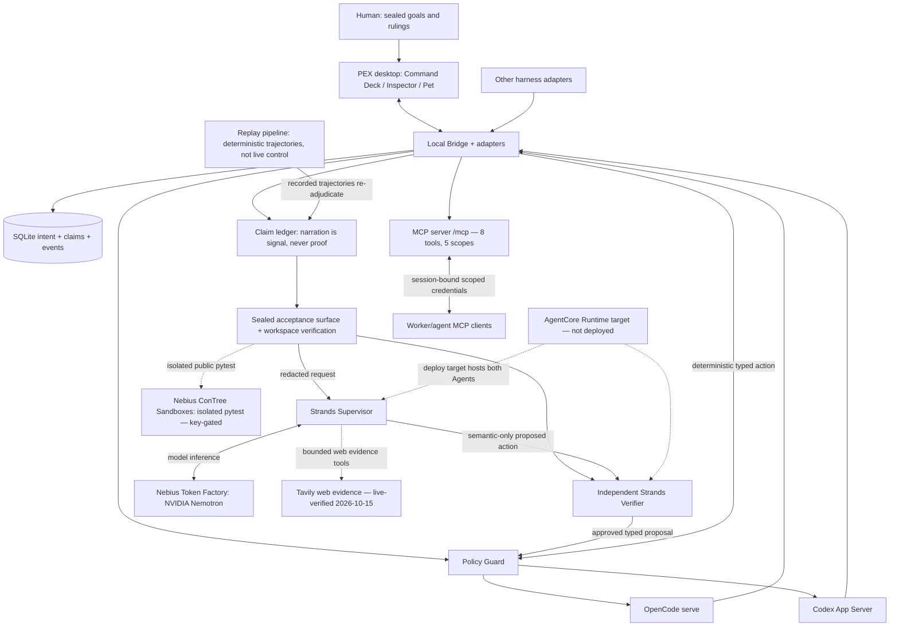

# Architecture

PEX is a personal adaptive control plane. The unit of optimization is the human + currently active AI workers + persistent intent.

## Invariants

- Local policy cannot be bypassed by the cloud supervisor.
- Typed actions only; no free-form shell from the model.
- Secrets are redacted before cloud.
- Adapter capabilities are negotiated, never assumed equal.
- Progress is evidence-based.
- Bounded intervention: a delivered correction the worker engages but does not
  resolve is a human decision (`ASK_HUMAN`, once), never an unbounded nudge loop.
- AgentCore Runtime / Memory / CloudWatch are optional deployment integrations. They are not claimed as live until deployed.
- The mounted MCP server is a scoped surface, not a backdoor: session-bound credentials carry `mcp:read` plus five write scopes (`pex.verify_claim`, `pex.report_progress`, `pex.request_decision`, `pex.handoff`, `pex.check_action`), are bound to one session+goal+vendor triple, expire, and a superseded goal invalidates them; anonymous local callers are read-only.
- Recorded replays re-enter the same claim/verification path but are sealed: `replay: true` + `not_live_control: true` are immutable once set, and every live-worker mutation surface (messages, focus, synthetic events, credential issuance, handoff targeting, re-seeding) refuses them server-side with 409. Escalation rulings on replay sessions are still recorded durably — the human's answer is intent, not worker delivery.

## Strands usage

The current live path creates one fresh Strands supervisor for each semantic STOP inspection and requires a validated structured decision. Sixteen request-scoped tools are defined in `evidence_tools` and offered dynamically per request — a STOP-decision call sees only the tight `inspect_acceptance` set plus the situational tools it may need, never the whole surface. Most expose immutable redacted evidence already gathered by the bridge (goal, decisions, scores, context items, the local verification receipt); a bounded subset reads live state under server-owned guards (`inspect_file`/`inspect_workspace`/`inspect_git`/`inspect_process`), and two reach the public web (`web_search`, `scrape_url`, clipped and request-scoped). None can execute code, write arbitrary files, call a harness, or mutate PEX. Their actual use is recorded in `evidence_tools`.

A semantic-only intervention must pass a second fresh independent verifier Agent over the same bounded evidence. Rejection, missing evidence, malformed output, failure, or timeout fails closed to deterministic NOOP. Locally evidenced completion/corrections remain authoritative, and local policy still owns execution. Deterministic scoring stays in the bridge so token deltas do not each call a model. If no supervisor model is configured, triage is deterministic and `used_llm=false`.

The previous unused verifier Graph was removed. The current two-Agent workflow is real but is not presented as a Strands Graph. Side-effect tools remain unimplemented rather than being exposed unsafely; the bounded public-web evidence tools (`web_search`, `scrape_url`) are request-scoped, clipped, and their use is recorded in `evidence_tools`.

AgentCore entrypoint: `python -m pex_supervisor.runtime` exposing `/invocations` and `/ping`. Image exists; runtime is not deployed.
